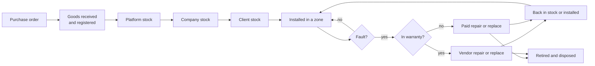
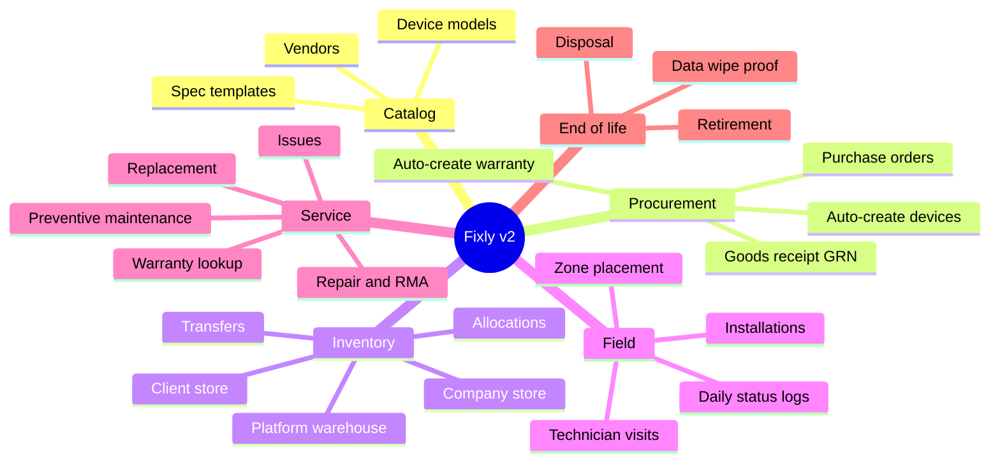
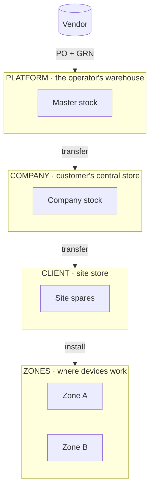
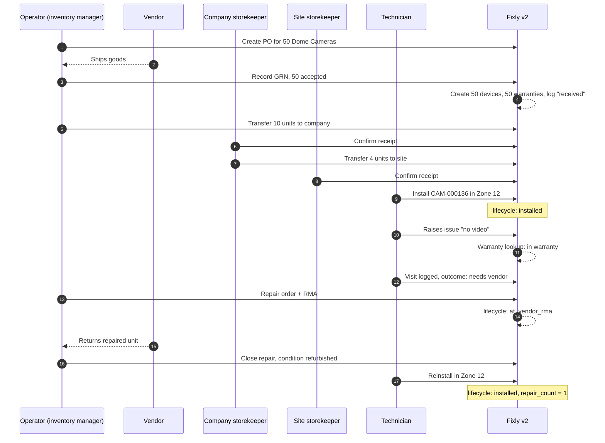

# 01 · Overview

## 1. What problem are we solving?

Today Fixly knows that "camera CAM-000136 is in Zone 12 of Rajgir Zoo Safari and is active". It cannot answer:

- Where did this camera come from, who sold it, what did it cost?
- Is it still under warranty?
- Which spare cameras do we hold, and in whose store?
- Who carried it to the site, who installed it, and when?
- It broke: was it repaired, replaced, sent to the vendor, scrapped? Where is it now?

Fixly v2 answers all of these by tracking **every physical device from purchase to disposal**.

## 2. Before and after

| Question | Fixly v1 (today) | Fixly v2 |
|---|---|---|
| What is a device? | One row mixing "model" and "physical unit" | A **model** (what you order) plus one **device** row per serial number |
| Where is a spare? | Cannot be represented (no stock concept) | **Stock locations** at three levels: platform, company, client |
| Who moved it? | Not recorded | **Stock transfers** with dispatcher, receiver, condition, tracking |
| Where was it installed? | Overwritten on every move | **Installations** history: zone, position, GPS, installer |
| Warranty? | Not tracked | **Warranties** per device, looked up automatically when an issue is raised |
| Repair? | Not tracked | **Repair orders** with RMA number, cost, parts, round trip |
| Replacement spare? | Free text, no link | Real link to the replacement device and the transfer that moved it |
| Status? | 5 values mixing health and place | **Lifecycle** (14 values) and **health** kept separate |
| History? | None | Append-only **lifecycle event log** |
| End of life? | None | **Disposal** record with approver and data-wipe certificate |
| Login? | Own user table, 5 fixed roles | FBOS **Identity**, per-user permissions |
| UI? | Fixly web app | **FBOS admin app** (Fixly web kept until parity) |

## 3. The six capabilities

## 4. Vocabulary (one glossary for both products)

Fixly and FBOS use some of the same words for different things. In v2 we fix the words once.

| Say this | It means | Fixly v1 called it | FBOS calls it | Note |
|---|---|---|---|---|
| **Operator** (vendor org) | The hardware business running the system | Platform / super admin | Identity **Organization** | Every inventory row carries `organization_id` |
| **Customer** | A business that buys or uses devices, e.g. Rajgir Zoo Safari | Company | Revenue **client** | Linked by `fbos_customer_id` |
| **Site** | A facility of a customer | Client | Org unit (recommended) | The API never calls a site "client" |
| **Zone** | A nested area inside a site | Zone | — | Stays in inventory |
| **Device model** | A product you can order (SKU) | Product type | — | New |
| **Device** | One physical unit with a serial number | Device | — | One row per serial |
| **Stock location** | Any place a device can sit when not installed | — | — | New |
| **GRN** | Goods Receipt Note: proof goods arrived | — | — | New |
| **RMA** | Return Merchandise Authorization: vendor repair ticket | — | — | New |
| **Lifecycle status** | Where the device is in its life | `status` | — | New, 14 values |
| **Health status** | Is it working today | — | — | New, independent |

## 5. Three levels of stock

Two ideas keep this clean:

- **Custody is not ownership.** A device is held by one company and one site at a time (custody), but may be owned by someone else (a lent device). Both fields exist.
- **A device is in exactly one place.** Either in a stock location or installed in a zone. Never both, never neither (except in transit, lost or disposed).

## 6. A worked example: CAM-000136

A Dome Camera is ordered, delivered, installed, fails, gets repaired under warranty and returns to service.

Every arrow that changes the device also writes one row to the lifecycle log, so the whole story can be replayed in order.

## 7. What changes for each kind of person

| Person | Before | After |
|---|---|---|
| Inventory manager | Not possible in Fixly | Orders, receives, allocates, tracks warranties and repairs in FBOS |
| Company storekeeper | Not possible | Receives and forwards stock for their company |
| Site admin / zone in-charge | Raises issues, sees devices | Same, plus sees stock at their site and the full history of each device |
| Technician | Mobile app, issues and visits | Same app at first; later signs in via FBOS Identity and sees warranty status before visiting |
| Finance | Nothing | Warranty and repair costs, billable repairs linked to invoices (later phase) |
| Developers | Role checks in code | Permission codes; one identity system |

## 8. Scope boundaries

**In scope:** serial-tracked hardware (cameras, displays, networking), its purchase, stock, custody, installation, faults, repair, replacement, disposal, warranty and preventive maintenance plans.

**Out of scope for v2:**

- Bulk, non-serial items such as cables and power supplies (design doc §12, question 3).
- Corporate IT assets, software, subscriptions, credentials and vehicles: these stay in FBOS `09_assets`.
- Rewriting the Fixly backend in Python.
- A general event bus.
