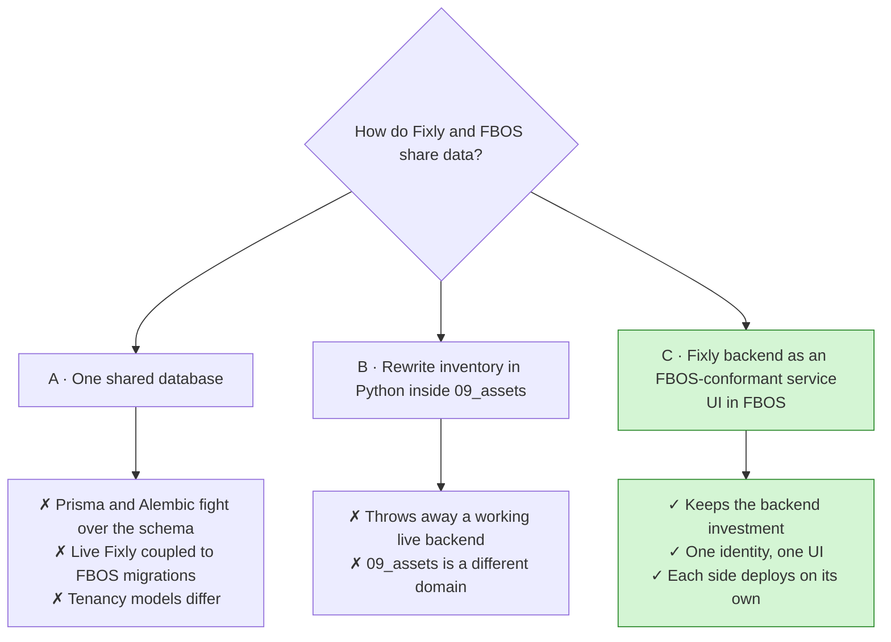
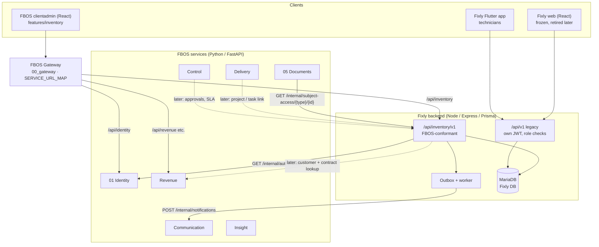
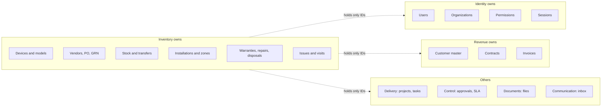
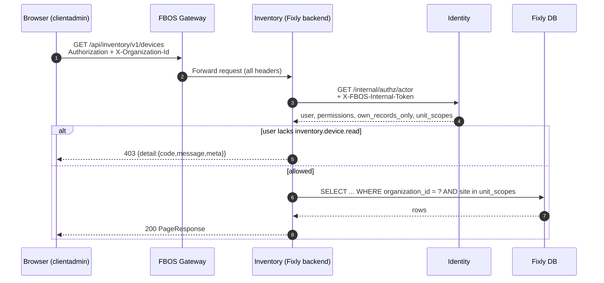
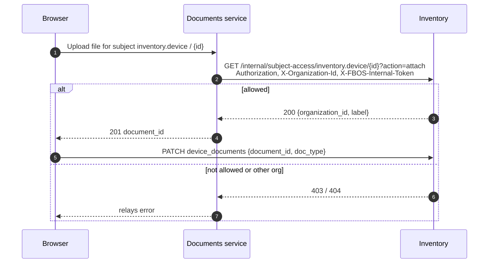
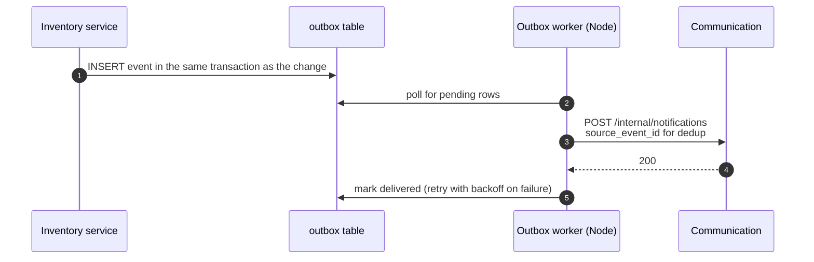
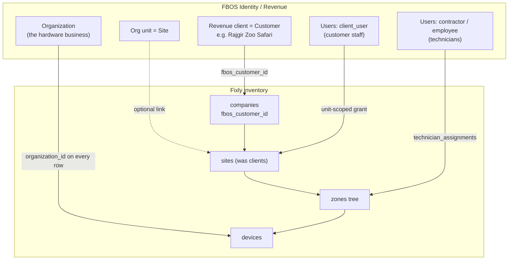

# 02 · Architecture and FBOS integration

## 1. Where each side is today

| | Fixly (live) | FBOS (in development) |
|---|---|---|
| Stack | Node 20, Express, Prisma, MariaDB, Socket.IO, FCM; React web + Flutter mobile | Python FastAPI, 10 services, Alembic, React clientadmin / superadmin |
| Sign-in | Own `users` table, 5 fixed roles, 7-day JWT | Identity service; per-user permission codes; roles are only presets |
| Tenancy | Company → Client (site) → Zone | Identity Client (tenant) → Organization → Org units; Revenue "client" = customer |
| Inventory | `devices` mixes model and unit; no stock, vendor, PO, warranty or repair | `09_assets`: IT-asset register (tags, custodian, credentials). Thin, no lifecycle |
| Data | 445 devices, 5 companies, 4 sites, 227 zones, 9 users, 8 issues | Shared remote MySQL for identity and revenue |

## 2. The decision: three options

**Chosen: Option C.** The Fixly Node backend stays the system of record for inventory and is exposed as a service named **`inventory`** at `/api/inventory/v1`.

## 3. Target architecture

Solid lines exist or are in Phases 1–4. Dotted lines are Phase 5.

### Boundary with `09_assets`

| `09_assets` (FBOS) | `inventory` (Fixly backend) |
|---|---|
| Software, subscriptions, credentials, vehicles, office IT | Field hardware with a lifecycle: cameras, displays, networking |
| Tag, custodian, vendor accounts | Serial, warranty, stock tier, installation, repair |

Do not build a second hardware lifecycle in `09_assets`. If one combined register view is wanted later, publish read-only events from inventory.

## 4. Who owns what (system of record)

| Concept | Owner | What others store |
|---|---|---|
| Users, orgs, permissions, sessions | Identity | the user's UUID |
| Customer master, contacts, tax, contracts, invoices | Revenue | `fbos_customer_id` on the inventory customer row |
| Devices, models, vendors, POs, GRNs, stock, transfers, installs, warranties, repairs, disposals, issues, visits, daily logs | Inventory | read via API; events out |
| Projects, work orders, tasks | Delivery | `work_unit_id`, `task_id` on installation / repair |
| SLA clocks, approvals | Control | `approval_request_id`, `sla_policy_id` |
| Files | Documents | `document_id` + subject type / id |
| In-app notifications | Communication | — |
| Cross-service audit | Insight (fed by events) | — (`device_lifecycle_events` stays the device history) |

**Rules of the road**

- No shared tables, no foreign keys across systems. Cross-references are plain UUID columns checked by an API call at write time.
- Each service migrates **only its own** database. Never run Alembic or Prisma migrate against a shared remote DB from a developer machine.

## 5. How a request travels

### 5.1 Reading the device list in FBOS

Key points:

- The inventory service **never trusts** a forwarded identity header. It asks Identity every time (with a short cache, 30 s like the legacy `authenticate` middleware).
- If Identity is down the service answers **503**, never "allow".
- Identity 401/404 are relayed unchanged.

### 5.2 Attaching a file to a device (Documents ⇄ Inventory)

Documents holds no access rules of its own. It asks the owning service. Subject types: `inventory.device`, `inventory.purchase_order`, `inventory.goods_receipt`, `inventory.repair_order`, `inventory.disposal`, `inventory.issue`. An organization mismatch is returned as 404 so ids cannot be probed.

### 5.3 Telling people something happened (notifications)

FBOS has **no event bus**. The pattern used elsewhere in FBOS (`03_delivery` outbox + worker) is reused. In v2 the only destination is Communication. Other services get explicit endpoints later.

## 6. Tenancy mapping (the hard part)

| Fixly concept | FBOS concept | How |
|---|---|---|
| The hardware business | Identity **Organization** | `organization_id` on every inventory row |
| Company (customer) | Revenue **client** (customer) | `companies.fbos_customer_id` |
| Client (site) | Org unit (recommended) | Stays an inventory table, keyed by customer |
| Zone tree, installations | Inventory only | — |
| Fixly platform staff, technicians | Identity users (`employee` / `contractor`) | `users.fbos_user_id`; names resolved from Identity |
| Customer staff | Identity users `client_user` in the vendor org | Per-user grants with `scope_unit_id` or `self_only` |

Why **one organization with `client_user`s** and not one organization per customer: Identity limits organizations (default 2), and the vendor would lose a cross-customer view. Details in [06](06-access-and-permissions.md).

## 7. Integration points by FBOS service

| FBOS service | Change required | Phase |
|---|---|---|
| **Identity** | Add `inventory.*` permission codes **and** matching `SENSITIVE_READ_CODES` in one change; deploy before inventory routes | 2 |
| **Gateway** | Add `inventory` to `SERVICE_URL_MAP` and `config.py` | 2 |
| **Documents** | Add `inventory` to `subject_services` | 2 |
| **Communication** | Notification templates for transfers, issues, warranty expiry | 3–4 |
| **Revenue** | Internal read of customer + site contacts; later contract warranty / AMC terms and billable repairs → invoices | 5 |
| **Delivery** | Optional link from installation / replacement to a project or task | 5 |
| **Control** | Approvals for PO, repair cost, disposal; SLA for issues | 5 (D5) |
| **Insight** | Consumers for audit and reports | 5 |
| **Frontend** | `features/inventory/` module, Vite proxy `/api/inventory`, access gating | 2 onward |

## 8. Cross-cutting contracts

| Topic | Rule |
|---|---|
| Auth | Forward `Authorization` + `X-Organization-Id`; Identity decides; never read org/user from other headers |
| Permissions | `inventory.<entity>.<action>`; checked on every route; a test fails the build if a route has none |
| Record-level rules | "Own site", "assigned technician", "own records only" enforced in the service layer using `own_records_only` and `unit_scopes` |
| Errors | `{ "detail": { "code", "message", "meta" } }` |
| Lists | `PageResponse` (items, total, page, page size) |
| Concurrency | `If-Match` / `version` on mutable aggregates |
| Retries | `Idempotency-Key` on transfers, GRN registration, repair dispatch |
| Ids | UUIDs everywhere |
| Money | Currency + GST on PO lines and repair costs; base currency from the organization |
