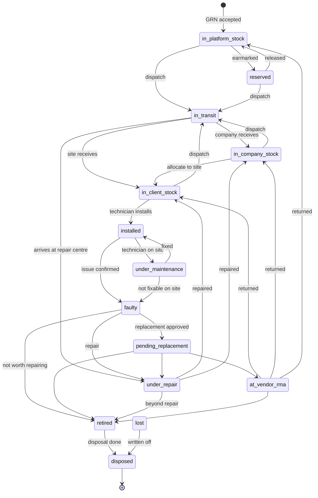
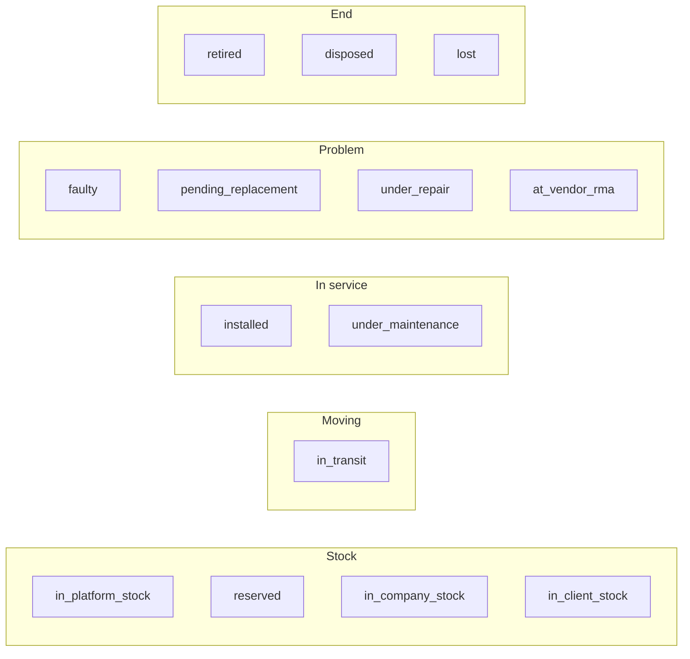
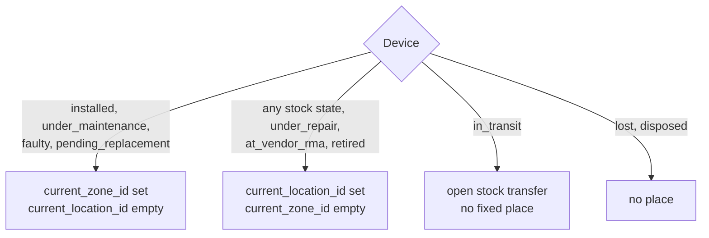

# 03 · Device lifecycle

A device has **two independent descriptions**:

| Field | Answers | Values |
|---|---|---|
| `lifecycle_status` | Where is it in its life? | 14 values (below) |
| `health_status` | Is it working today? | `working`, `not_working`, `needs_attention` (from daily status logs) |

A device can be `installed` and `not_working` at the same moment. That mismatch is exactly what raises an issue.

## 1. State machine

`lost` can be reached from any state when a device goes missing.

## 2. Each state in plain words

| Status | Meaning | Where it physically is | Group |
|---|---|---|---|
| `in_platform_stock` | Received, passed QC, available | Operator's warehouse | Stock |
| `reserved` | Earmarked for a company, site or replacement | Same stock location | Stock |
| `in_transit` | Dispatched, not yet received | An open stock transfer | Moving |
| `in_company_stock` | In the customer company's store | Company store | Stock |
| `in_client_stock` | In a site's store, ready to install | Site store | Stock |
| `installed` | Placed and working in a zone | Zone (active installation) | In service |
| `under_maintenance` | Technician working on site | Zone | In service |
| `faulty` | Issue confirmed; device still there or just removed | Zone or site store | Problem |
| `pending_replacement` | Replacement approved, swap not done | Zone | Problem |
| `under_repair` | In-house or service-centre repair | Service-centre location | Problem |
| `at_vendor_rma` | Sent to vendor for warranty repair or exchange | Vendor location | Problem |
| `retired` | Out of service, waiting for disposal | Any store | End |
| `disposed` | Scrapped, sold, recycled or returned | Disposal | End (terminal) |
| `lost` | Missing or stolen | Unknown | End |

## 3. Where a device can be (the single-place rule)

Special stock locations: `in_transit`, `vendor`, `service_center`, `disposal`.

## 4. Custody and ownership

| Field | Meaning |
|---|---|
| `owner_company_id`, `ownership_type` | Who owns the device: `platform_owned`, `company_owned`, `client_owned` or `leased` |
| `current_company_id`, `current_client_id` | Who holds it right now (custody) |
| `device_allocations` | History of who it was given to, with `allocated_at` and `released_at` |

> **Open decision D3:** the default `ownership_type` for existing devices. The design doc assumes `company_owned`. Confirm before migration. See [10](10-decisions-and-open-questions.md).

## 5. The audit trail

Every change to status, location, company, client or zone writes **one** row to `device_lifecycle_events` **in the same transaction**. Rows are never edited or deleted.

| Column | Example |
|---|---|
| `event_type` | `received`, `stocked`, `allocated`, `transferred`, `installed`, `relocated`, `status_changed`, `issue_raised`, `visit_done`, `warranty_claimed`, `repair_sent`, `repair_returned`, `replaced`, `retired`, `disposed` (plus `imported_from_v1` for the backfill) |
| `from_status` → `to_status` | `installed` → `faulty` |
| `from_location` → `to_location` | Zone 12 → Site store |
| `reference_type` / `reference_id` | `purchase_order`, `transfer`, `installation`, `issue`, `repair_order`, `replacement_request` or `disposal` |
| `occurred_at`, actor | when and who |

The "Full life of one device" query in [05](05-data-model.md) reads this table.

## 6. Mapping existing data

| v1 `devices.status` | v2 `lifecycle_status` |
|---|---|
| `active` | `installed` |
| `under_maintenance` | `under_maintenance` |
| `faulty` | `faulty` |
| `retired` | `retired` |
| `provisioned` with a zone | `installed` |
| `provisioned` without a zone | `in_client_stock` |

**Integration note (change 12):** in the live database the old `status` column is **kept** and a new `lifecycle_state` column is added beside it. Altering a MariaDB enum is not additive and would lock and rewrite the table. The old column is retired in Phase 6.
