# 04 · Process flows

Each flow shows **who does what**, **which screen or API** is involved, and **what is written**. The Eraser flowcharts these are based on are [`08`](../diagrams/08-flow-device-journey.eraser) and [`09`](../diagrams/09-flow-fault-handling.eraser).

Index: [A Procurement](#a-procurement-and-receiving) · [B Stock movement](#b-stock-movement-transfers) · [C Installation](#c-installation) · [D Daily operations](#d-daily-operations) · [E Fault handling](#e-fault-handling) · [F Warranty claim](#f-warranty-claim-and-rma) · [G Replacement](#g-replacement) · [H Repair](#h-repair-round-trip) · [I Disposal](#i-retirement-and-disposal) · [J Preventive maintenance](#j-preventive-maintenance-amc) · [K Customer onboarding](#k-onboarding-a-new-customer-and-site)

---

## 0. The master flow

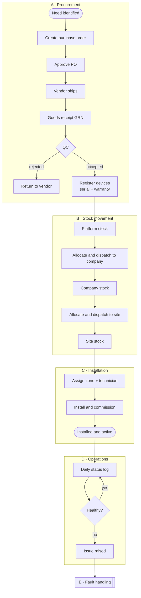

---

## A. Procurement and receiving

**Who:** inventory manager (operator). **Where:** FBOS → Inventory → Purchasing.

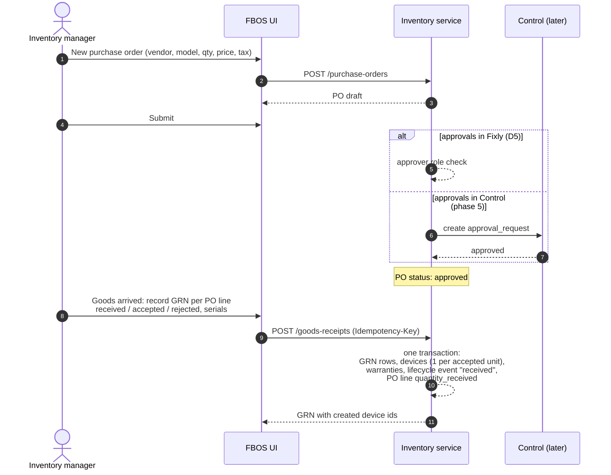

**Rules that apply**

| Rule | Effect |
|---|---|
| Receiving gate (§8 rule 11) | Accepted quantity on a GRN line = number of device rows created |
| Warranty at registration (rule 6) | `end_date = start_date + default_warranty_months`; start is GRN date or install date per vendor terms |
| Asset tag (rule 13) | Device `code` from the existing category sequence (e.g. `CAM-000136`) |
| Required at receiving | Serial, model, price, receiving location (fixes the empty-data problem in v1) |

**PO status** (`purchase_orders.status`): `draft → submitted → approved → partially_received → received`, or `cancelled`. **GRN status:** `pending_qc → accepted | partially_accepted | rejected`.

---

## B. Stock movement (transfers)

The same flow is used at every tier. Only the actors and the `transfer_type` change.

| `transfer_type` | From → To | Dispatcher | Receiver |
|---|---|---|---|
| `platform_to_company` | Platform warehouse → company store | Inventory manager | Company storekeeper |
| `company_to_client` | Company store → site store | Company storekeeper | Site storekeeper |
| `client_to_client` | Site store → another site store | Site storekeeper | Site storekeeper |
| `return_to_company` / `return_to_platform` | Back up one tier | Lower tier | Upper tier |
| `replacement_dispatch` | Any store → site | Whoever holds the spare | Technician / site |
| `to_repair` / `from_repair` | Site ⇄ in-house repair centre | Sender | Repair centre / store |
| `to_vendor_rma` / `from_vendor_rma` | Store ⇄ vendor | Operator | Vendor / store |

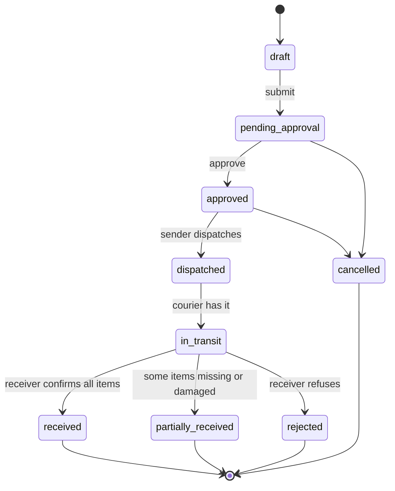

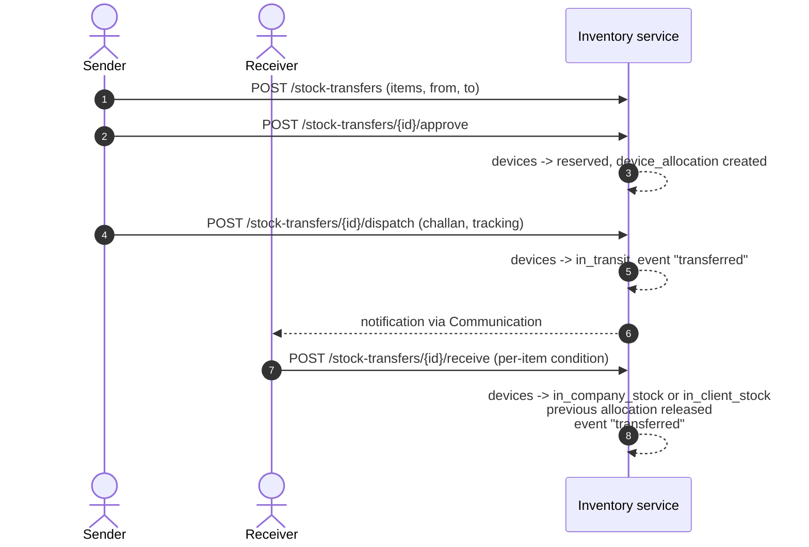

**Rules:** one open transfer per device (rule 4); each item gets `condition_in` and an `item_status` of `pending`, `received`, `missing` or `damaged`, so a partial receive shows exactly which units need follow-up.

---

## C. Installation

**Who:** technician (mobile app now; FBOS later).

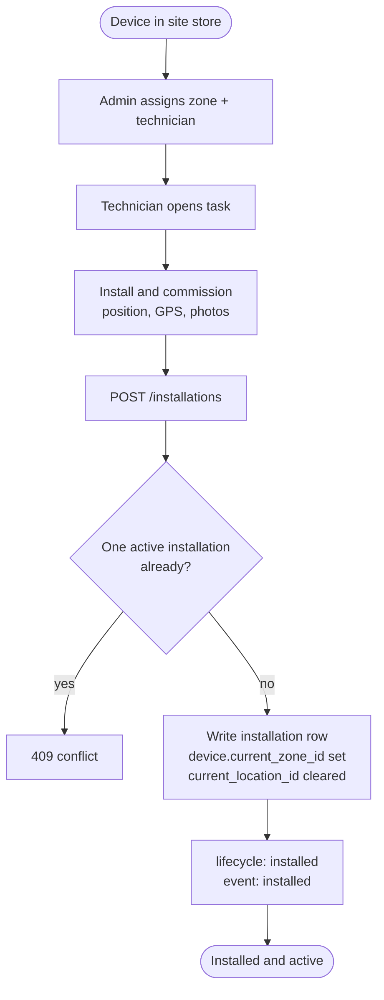

**Installation types** (`installation_type`): `new`, `replacement`, `relocation`, `reinstall_after_repair`. **Removal reasons:** `faulty`, `replaced`, `relocated`, `upgraded`, `retired`.

---

## D. Daily operations

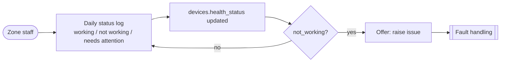

One log per device per day (existing v1 constraint). Issues can also be raised manually or by an automatic alert (`issues.raised_via`).

---

## E. Fault handling

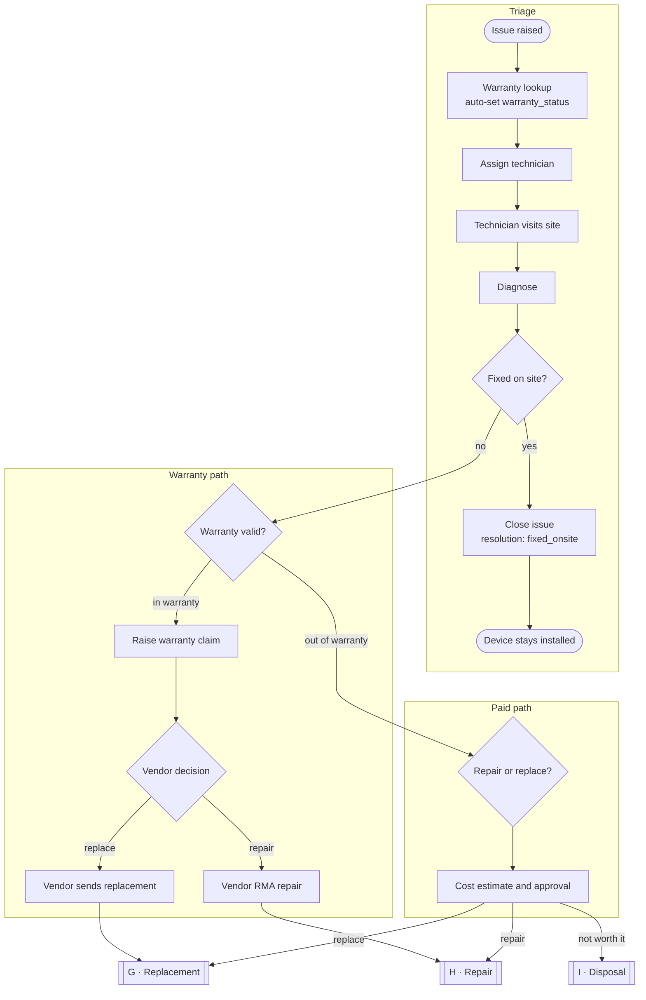

**Issue status** (history kept in `issue_status_history` with GPS): `open → assigned → in_progress → resolved → closed`, with `on_hold` and `reopened` as side paths. **Resolution types:** `fixed_onsite`, `replaced`, `repaired_offsite`, `warranty_rma`, `no_fault_found`, `not_repairable`.

**Visit** (`service_visits`): `visit_type` is `diagnosis`, `onsite_repair`, `replacement_swap`, `removal` or `preventive`; status `scheduled → en_route → on_site → completed` (or `cancelled`, `no_access`); check-in/out, GPS, findings, signature; `outcome` is `fixed`, `needs_replacement`, `needs_repair`, `no_fault_found` or `parts_pending`.

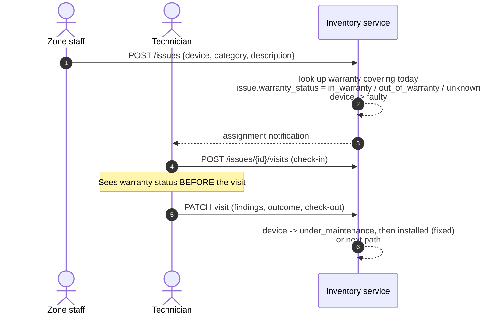

---

## F. Warranty claim and RMA

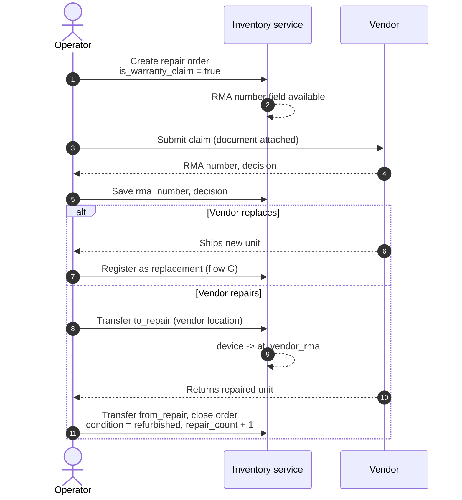

---

## G. Replacement

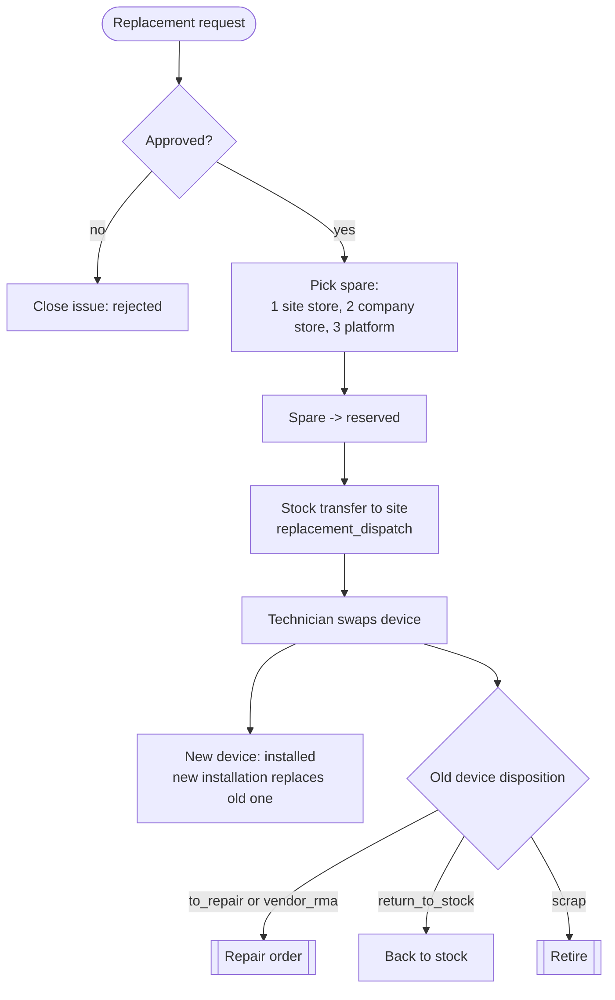

The spare selection order is configurable (rule 8). **Loaner during repair** is modelled as a normal replacement with disposition `to_repair`.

---

## H. Repair round trip

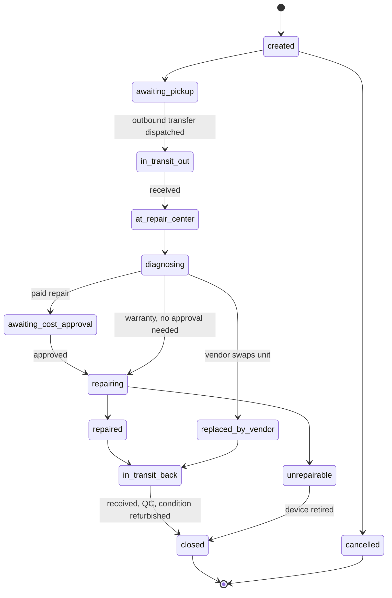

| Rule 9 | Detail |
|---|---|
| Needs | An outbound transfer to a `service_center` or `vendor` location and a return transfer |
| On close | Device goes to the return location's tier stock, `condition = refurbished`, `repair_count + 1` |
| Costs | `cost_estimate`, `final_cost`, `cost_borne_by` (customer / operator / vendor); parts in `repair_parts` with `covered_by_warranty` |
| Billing (phase 5) | `billable` + `invoice_id` link to Revenue |

---

## I. Retirement and disposal

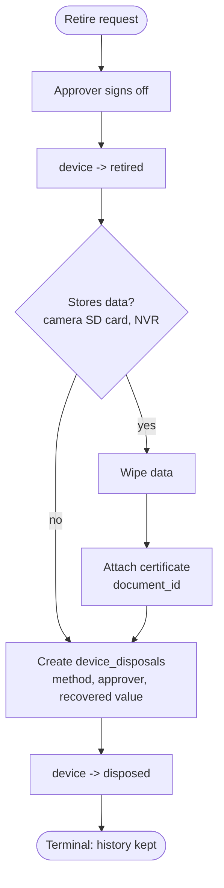

**Disposal gate (rule 10):** devices that store data cannot become `disposed` until `data_wiped = true` and a certificate is attached. Devices are **never deleted**; history is kept.

**Disposal methods:** `scrap`, `recycle`, `sold`, `returned_to_vendor`, `donated`, `lost`, `stolen`.

---

## J. Preventive maintenance (AMC)

> New in v2.1 (integration change 9). v2 covered corrective maintenance only; "preventive" existed as a `visit_type` with nothing generating it.

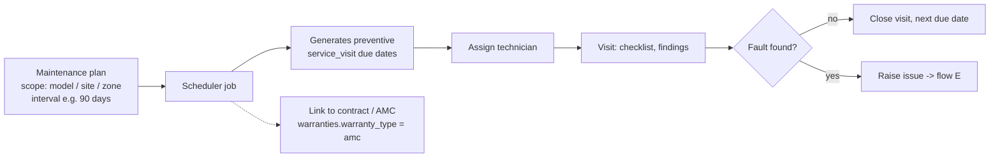

---

## K. Onboarding a new customer and site

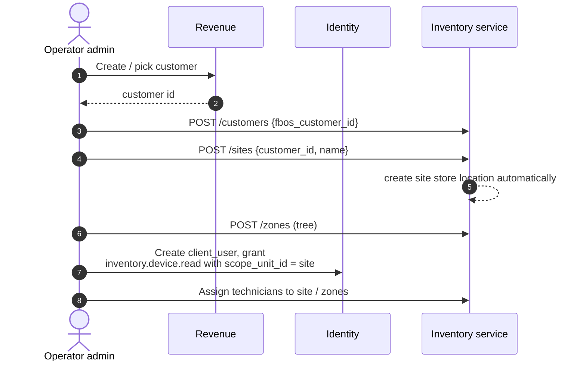

Auto-created: one `company_store` per customer and one `client_store` per site (migration step 2 does this for the existing 5 and 4).
