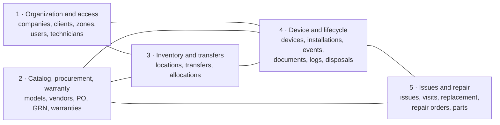
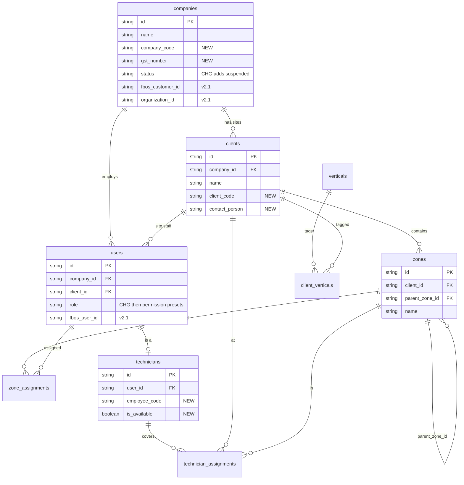
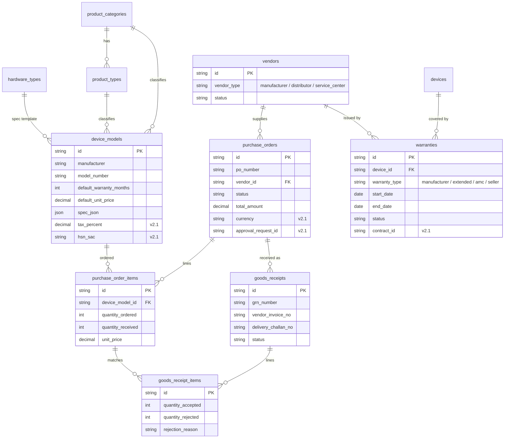
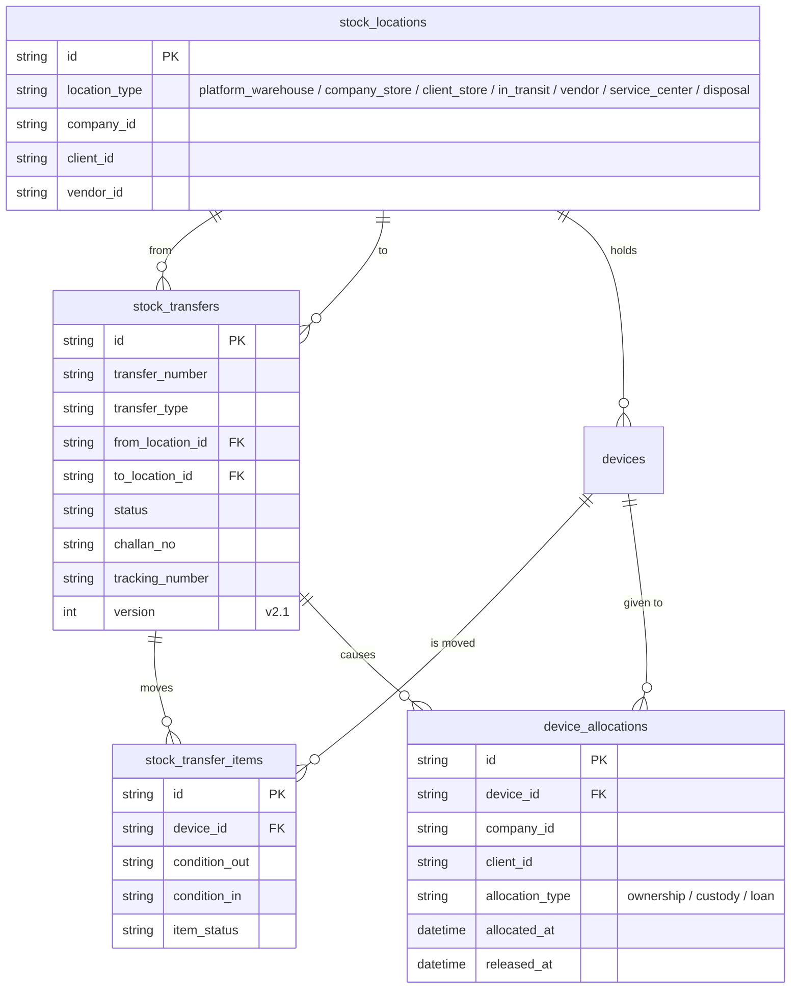
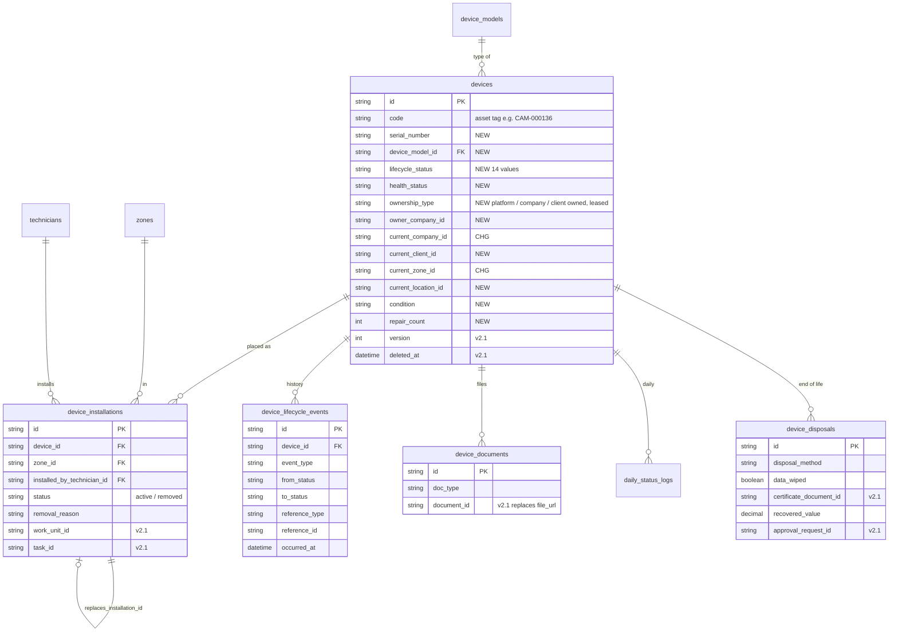
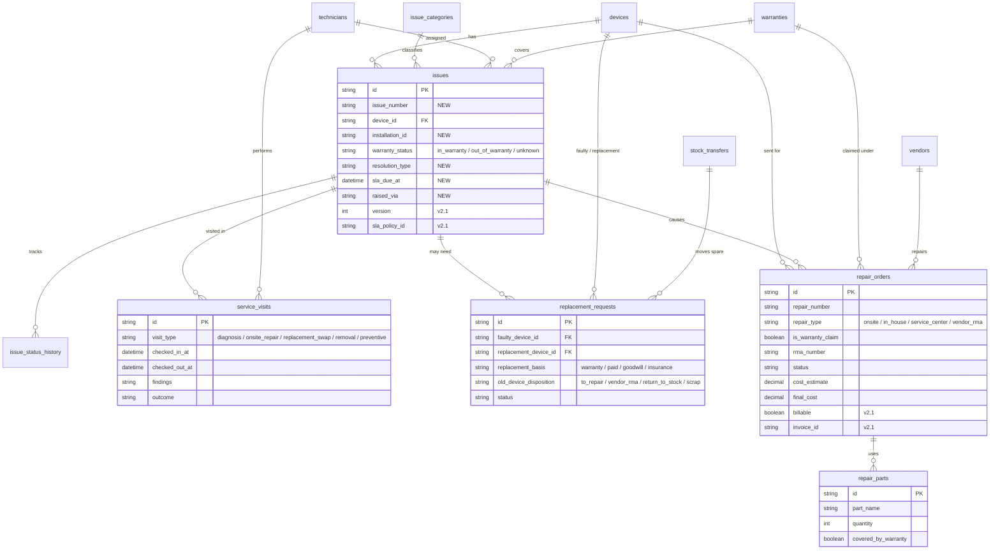

# 05 · Data model

Column-level truth lives in the Eraser sources: [`../diagrams/02`](../diagrams/02-v2-domain1-organization-access.eraser) … [`06`](../diagrams/06-v2-domain5-issues-repair.eraser), with the whole system in [`07`](../diagrams/07-v2-full-overview.eraser) (36 tables). This page gives the same model as readable diagrams plus the v2.1 changes needed for FBOS.

Conventions: **NEW** = new in v2, **CHG** = changed from v1, **v2.1** = added by the FBOS integration.

## 1. Domain map



## 2. Domain 1 — Organization and access



## 3. Domain 2 — Catalog, procurement, warranty



## 4. Domain 3 — Inventory, transfers, allocation



## 5. Domain 4 — Device, installation, lifecycle log



## 6. Domain 5 — Issues, visits, repair, replacement



## 7. Platform tables added by the FBOS integration (v2.1)

Not drawn in the Eraser diagrams yet. Add them to diagram 07 when the schema is generated.

| Table | Purpose |
|---|---|
| `outbox` | Events to deliver, written in the same transaction as the change; polled by the worker |
| `idempotency_keys` | Replay protection for transfers, GRN registration, repair dispatch |
| `fbos_links` | Mapping audit (Fixly user / company ↔ FBOS id) |
| `maintenance_plans` | Preventive maintenance schedule (scope, interval, next due) |
| `code_sequences` | Phase 6 only: replaces `product_categories.last_seq` |
| `processed_events` | Only if a consumer is added later |

## 8. Integrity rules

| # | Rule | How it is enforced |
|---|---|---|
| 1 | **Single place:** installed (zone) **or** in a stock location | Service layer + check on write; exceptions `in_transit`, `lost`, `disposed` |
| 2 | **One active installation per device** | MariaDB generated column `active_flag = IF(status='active',1,NULL)` + `UNIQUE(device_id, active_flag)` (raw SQL in migration) |
| 3 | **One active custody allocation per device** | Same technique on `device_allocations` |
| 4 | **One open transfer per device** | Checked when adding an item to a transfer |
| 5 | **Atomic history** | Status/location change and `device_lifecycle_events` insert share one transaction; optional DB trigger as a safety net |
| 6 | **Warranty at registration** | Created in the GRN transaction |
| 7 | **Warranty lookup on issue** | Done when the issue row is created |
| 8 | **Spare selection order** | Site → company → platform; configurable; chosen spare becomes `reserved` |
| 9 | **Repair round trip** | Outbound and return transfers required to close |
| 10 | **Disposal gate** | Approver + `data_wiped` + certificate for data-bearing devices |
| 11 | **Receiving gate** | Accepted qty = devices created |
| 12 | **Tenant isolation** | Company roles see their own devices; site users see only their site; operator sees all |
| 13 | **Asset tag** | Existing `last_seq` generator kept until Phase 6 |
| 14 | **Soft integrity** | Never cascade-delete devices with history. v2.1 changes `Issue → Device` from cascade to Restrict and adds `deleted_at` |
| 15 | **Zone delete guard (v2.1)** | Block deleting a zone while devices are installed (v1 would silently turn them into "stock") |

## 9. Useful queries

```sql
-- Where is each device and who holds it
SELECT d.code, dm.name AS model, d.lifecycle_status,
       co.name AS company, cl.name AS client,
       z.name AS zone, sl.name AS stock_location
FROM devices d
LEFT JOIN device_models dm   ON dm.id = d.device_model_id
LEFT JOIN companies co       ON co.id = d.current_company_id
LEFT JOIN clients cl         ON cl.id = d.current_client_id
LEFT JOIN zones z            ON z.id  = d.current_zone_id
LEFT JOIN stock_locations sl ON sl.id = d.current_location_id;

-- Full life of one device
SELECT occurred_at, event_type, from_status, to_status, notes
FROM device_lifecycle_events WHERE device_id = :id ORDER BY occurred_at;

-- Warranties expiring in 60 days
SELECT d.code, w.end_date, v.name AS vendor
FROM warranties w
JOIN devices d ON d.id = w.device_id
LEFT JOIN vendors v ON v.id = w.vendor_id
WHERE w.status = 'active'
  AND w.end_date BETWEEN CURDATE() AND CURDATE() + INTERVAL 60 DAY;
```

More queries (stock on hand, out for repair, repeat failures, transfers in transit) are in [design doc §10](../fixly-v2-design.md#10-useful-queries-mariadb).

## 10. Data quality in the live database

| Finding (from the dump) | Action |
|---|---|
| `custom_spec` holds the text `'null'` in 344 devices | Convert to real `NULL` |
| Price, purchase date, install date, hardware type, location empty on all 445 devices | Collect; make required at receiving |
| 2 replacement requests have no spare attached | Leave `replacement_device_id` null |
| 0 daily status logs | Nothing to migrate; health starts from first log |
