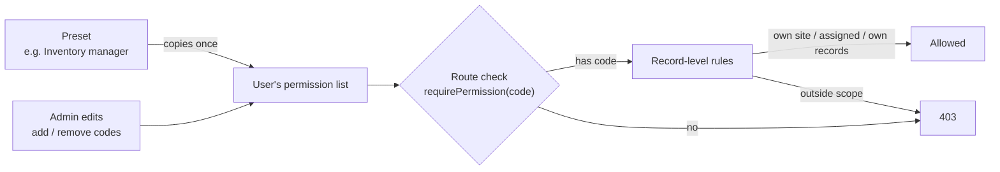
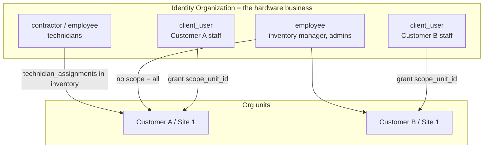
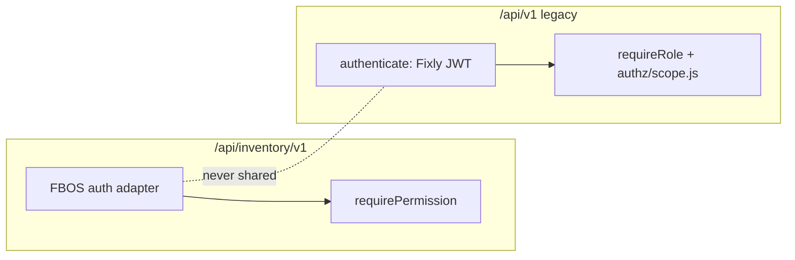

# 06 · Access and permissions

## 1. The model in one minute

FBOS is **user-based, not role-based**. Every user has an explicit list of permission codes. "Roles" exist only as **presets**: a convenient bundle that fills in the list when you create a user. Code never asks "is this user an inventory_manager?"; it asks "does this user have `inventory.purchase_order.create`?".

Two layers decide access:

| Layer | Question | Where |
|---|---|---|
| **Permission** | May this user do this *kind* of thing? | Identity (`/internal/authz/actor` → `permissions`) |
| **Scope** | May they do it on *this* record? | Inventory service, using `unit_scopes` and `own_records_only` from the same response |

## 2. Permission codes (proposed)

Format `inventory.<entity>.<action>`. Add to Identity's `PERMISSION_CATALOG`.

| Entity | Actions |
|---|---|
| `device` | `read`, `create`, `update`, `delete` |
| `device_model` | `read`, `create`, `update` |
| `vendor` | `read`, `create`, `update` |
| `purchase_order` | `read`, `create`, `update`, `approve` |
| `goods_receipt` | `read`, `create` |
| `stock_location` | `read`, `create`, `update` |
| `stock_transfer` | `read`, `create`, `approve`, `dispatch`, `receive` |
| `installation` | `read`, `create`, `update` |
| `warranty` | `read`, `create`, `update` |
| `issue` | `read`, `create`, `update`, `assign` |
| `service_visit` | `read`, `create`, `update` |
| `replacement` | `read`, `create`, `approve` |
| `repair_order` | `read`, `create`, `update`, `approve` |
| `disposal` | `read`, `create`, `approve` |
| `maintenance_plan` | `read`, `create`, `update` |
| `report` | `read` |

The exact list is finalized in the Phase 0 spike and published as an OpenAPI file.

### ⚠ Sensitive codes

> Every `.read` code **joins the `member` preset automatically**. `SENSITIVE_READ_CODES` is a hard-coded set in Identity. Anything that exposes **cost, price, vendor terms, disposals or other customers' data** must be added to that set **in the same Identity change**, or every ordinary member gets it.

Candidates: `inventory.purchase_order.read`, `inventory.vendor.read`, `inventory.repair_order.read` (costs), `inventory.disposal.read`, `inventory.warranty.read` (terms), `inventory.report.read`.

**Deploy order:** Identity first (codes + sensitive set), then inventory routes.

## 3. Roles become presets

The design doc's capability matrix ([§8](../fixly-v2-design.md#role-capability-matrix)) maps onto presets like this:

| Preset (not checked in code) | Typical permissions |
|---|---|
| Inventory manager | vendor, model, PO (create/approve), GRN, stock_transfer (create/approve/dispatch), repair_order, disposal (approve), warranty |
| Company storekeeper | stock_transfer (receive, create company→site), device.read for the company |
| Company admin | issue create/assign, replacement approve, repair_order approve (cost), reports |
| Site storekeeper | stock_transfer.receive for their site |
| Site admin / zone in-charge | issue create, device.read for site, stock.read for site |
| Technician | installation create, service_visit create/update, issue update (assigned) |
| Super admin | all inventory codes |

| Action (from the original matrix) | Permission code |
|---|---|
| Manage vendors, models, POs, GRN | `vendor.*`, `device_model.*`, `purchase_order.*`, `goods_receipt.*` |
| Allocate platform → company | `stock_transfer.create` + `.approve` |
| Receive at company / site store | `stock_transfer.receive` (scoped) |
| Install / swap | `installation.create` |
| Raise issue | `issue.create` |
| Assign technician | `issue.assign` |
| Log service visit | `service_visit.create` |
| Approve replacement / repair cost | `replacement.approve`, `repair_order.approve` |
| Create repair order / RMA | `repair_order.create` |
| Approve disposal | `disposal.approve` |

## 4. Who is who in Identity

| Person | Identity `user_type` | Scoping |
|---|---|---|
| Operator staff | `employee` | Unscoped grants: sees every customer |
| Technician | `contractor` or `employee` | Coverage in inventory `technician_assignments`; `own_records_only` for visits |
| Customer staff | `client_user` | Per-user grants with `scope_unit_id` (site) or `self_only` |

### D1 — the decision behind this

| Option | Verdict |
|---|---|
| One Identity organization **per customer** | Rejected: `max_organizations` defaults to 2 and the vendor loses the cross-customer view |
| **`client_user`s inside the vendor org, scoped by org unit** | **Recommended.** Identity already has the type and unit-scoped grants (verified in `01_identity`) |
| `client_user` with `self_only` grants + site/zone assignments held in inventory | Fallback ("b-lite") if sites are not modelled as org units |

### The one risk to test first

`client_user` is **only a label** today. Each service must apply `unit_scopes` itself on every list and detail endpoint. A single missed filter shows one customer's devices to another. The Phase 0 spike proves the pattern end to end, and every list endpoint gets a cross-customer test.

## 5. Record-level rules

Carried over from the design doc (§8 rule 12) and applied in the service layer:

| Caller | Sees |
|---|---|
| Operator (unscoped) | Everything in the organization |
| Company role | Devices where `current_company_id` or `owner_company_id` is their company |
| Site role | Devices where `current_client_id` is their site (and its zones) |
| Technician | Issues and visits assigned to them; devices in their coverage |
| `own_records_only` | Only rows they created or are assigned to |

Anything outside the caller's scope returns **404**, not 403, so ids cannot be probed.

## 6. Preventing an unguarded route

FBOS Python services have a test that fails if a route has no permission guard. Node cannot reuse it, so Fixly adds an equivalent: **walk the Express router at test time and fail on any `/api/inventory/v1` route without `requirePermission`.**

## 7. Two auth stacks during the transition

Mounted as separate routers so they never share middleware or tokens. Fixly's nine users are matched to Identity by email (globally unique); passwords are reset rather than migrated. Fixly `User` rows stay as a mapping layer because `Technician.user` cascades from `User`.
