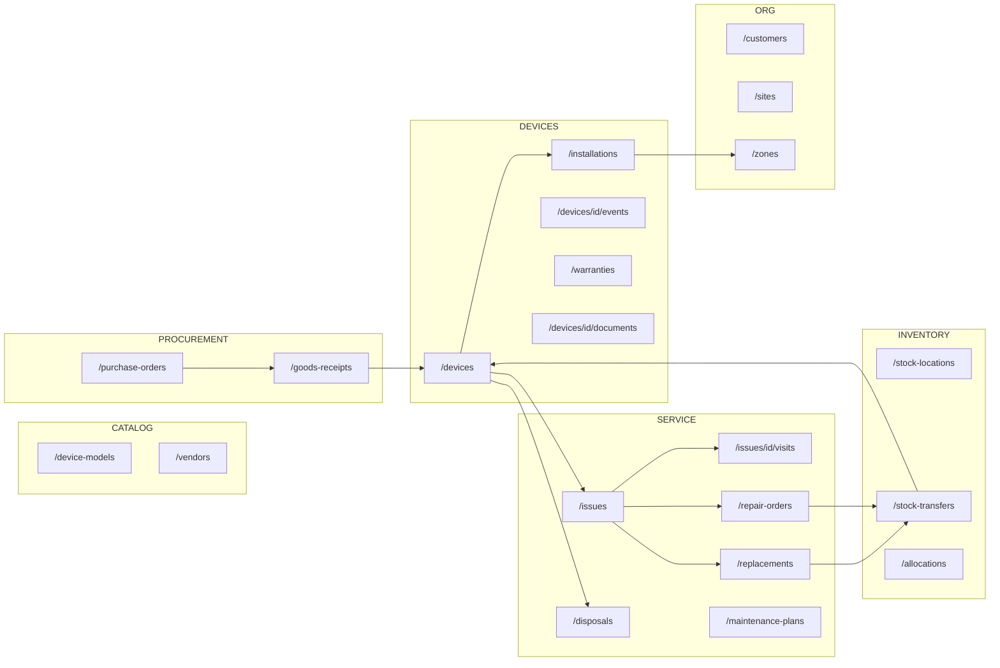
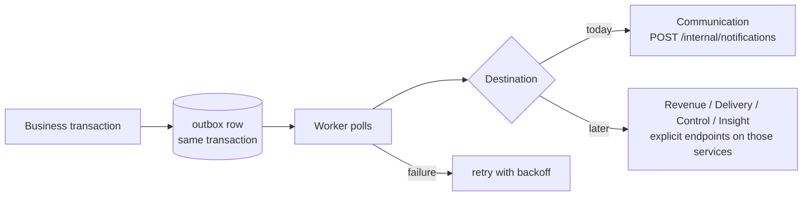

# 07 · API and events

> **Everything on this page is a proposal** to be finalized as an OpenAPI file in Phase 0. Resource names follow FBOS conventions (plural nouns). The legacy `/api/v1` API stays untouched.

## 1. Conventions

| Topic | Rule |
|---|---|
| Base path | `/api/inventory/v1` (via the FBOS gateway; dev: Vite proxy `INVENTORY_URL`) |
| Auth headers | `Authorization: Bearer <FBOS token>`, `X-Organization-Id` |
| Ids | UUID |
| Lists | `?page=&page_size=&sort=&q=` plus filters; response `PageResponse` |
| Errors | `{ "detail": { "code": "device_not_found", "message": "…", "meta": {} } }` |
| Concurrent edits | `If-Match: <version>` on `PATCH`/state changes; `409` on mismatch |
| Retries | `Idempotency-Key` header on transfers, GRN registration, repair dispatch |
| Deletes | Soft only (`deleted_at`); devices with history are never deleted |
| Health | `GET /health`, `GET /ready` |

### Error shape

```json
{
  "detail": {
    "code": "device_already_installed",
    "message": "Device CAM-000136 already has an active installation.",
    "meta": { "device_id": "…", "installation_id": "…" }
  }
}
```

| Status | When |
|---|---|
| 401 / 404 (actor) | Relayed from Identity |
| 403 | Missing permission code |
| 404 | Not found **or** outside the caller's scope or organization |
| 409 | Version mismatch, duplicate open transfer, second active installation |
| 422 | Rule violation (e.g. disposal without wipe certificate) |
| 503 | Identity unreachable |

## 2. Resource map



## 3. Endpoints (proposed)

### Organization

| Method | Path | Permission |
|---|---|---|
| GET | `/customers`, `/customers/{id}` | `inventory.device.read` (scoped) |
| POST / PATCH | `/customers`, `/customers/{id}` | `inventory.stock_location.update` |
| GET / POST / PATCH | `/sites`, `/sites/{id}` | `…stock_location.*` |
| GET / POST / PATCH / DELETE | `/zones`, `/zones/{id}` | DELETE blocked while devices installed (409) |

### Catalog and procurement

| Method | Path | Permission |
|---|---|---|
| GET / POST / PATCH | `/device-models` | `inventory.device_model.*` |
| GET / POST / PATCH | `/vendors` | `inventory.vendor.*` |
| GET / POST / PATCH | `/purchase-orders` | `inventory.purchase_order.*` |
| POST | `/purchase-orders/{id}/submit`, `/approve`, `/cancel` | `…purchase_order.update` / `.approve` |
| GET / POST | `/goods-receipts` | `inventory.goods_receipt.*` (POST needs `Idempotency-Key`) |

### Stock and movement

| Method | Path | Permission |
|---|---|---|
| GET | `/stock-locations`, `/stock-locations/{id}/stock` | `inventory.stock_location.read` |
| GET / POST | `/stock-transfers` | `inventory.stock_transfer.*` |
| POST | `/stock-transfers/{id}/approve` | `…stock_transfer.approve` |
| POST | `/stock-transfers/{id}/dispatch` | `…stock_transfer.dispatch` (`Idempotency-Key`) |
| POST | `/stock-transfers/{id}/receive` | `…stock_transfer.receive` (per-item condition) |
| POST | `/stock-transfers/{id}/cancel` | `…stock_transfer.create` |

### Devices

| Method | Path | Permission |
|---|---|---|
| GET | `/devices` (filter: model, status, site, zone, location, warranty) | `inventory.device.read` |
| GET | `/devices/{id}` | `inventory.device.read` |
| PATCH | `/devices/{id}` | `inventory.device.update` (`If-Match`) |
| GET | `/devices/{id}/events` | `inventory.device.read` (timeline) |
| GET | `/devices/{id}/warranties` | `inventory.warranty.read` |
| GET / POST | `/devices/{id}/documents` | `inventory.device.read` / `.update` |
| POST | `/installations` | `inventory.installation.create` |
| POST | `/installations/{id}/remove` | `inventory.installation.update` |
| POST | `/daily-status-logs` | `inventory.device.update` |

### Service

| Method | Path | Permission |
|---|---|---|
| GET / POST / PATCH | `/issues` | `inventory.issue.*` |
| POST | `/issues/{id}/assign` | `inventory.issue.assign` |
| GET / POST / PATCH | `/issues/{id}/visits` | `inventory.service_visit.*` |
| GET / POST | `/replacements` | `inventory.replacement.*` |
| POST | `/replacements/{id}/approve` | `inventory.replacement.approve` |
| GET / POST / PATCH | `/repair-orders` | `inventory.repair_order.*` |
| POST | `/repair-orders/{id}/dispatch` | `…repair_order.update` (`Idempotency-Key`) |
| POST | `/repair-orders/{id}/close` | `…repair_order.update` |
| GET / POST | `/disposals` | `inventory.disposal.*` |
| POST | `/disposals/{id}/approve` | `inventory.disposal.approve` |
| GET / POST / PATCH | `/maintenance-plans` | `inventory.maintenance_plan.*` |

### Reports

| Method | Path | Source |
|---|---|---|
| GET | `/reports/stock-on-hand` | [design doc §10](../fixly-v2-design.md#10-useful-queries-mariadb) |
| GET | `/reports/warranty-expiry` | same |
| GET | `/reports/open-repairs` | same |
| GET | `/reports/repeat-failures` | same |
| GET | `/reports/transfers-in-transit` | same |

## 4. Example: receiving goods

```http
POST /api/inventory/v1/goods-receipts
Authorization: Bearer …
X-Organization-Id: 7e1c…
Idempotency-Key: 5f9a-grn-2026-10-14-001
Content-Type: application/json

{
  "purchase_order_id": "…",
  "receiving_location_id": "…",
  "vendor_invoice_no": "INV-8841",
  "items": [
    {
      "purchase_order_item_id": "…",
      "quantity_received": 50,
      "quantity_accepted": 49,
      "quantity_rejected": 1,
      "rejection_reason": "damaged lens",
      "units": [
        { "serial_number": "SN100001", "mac_address": "…" }
      ]
    }
  ]
}
```

One transaction creates the GRN, 49 devices, 49 warranties, 49 `received` events, and updates `quantity_received`. A repeat of the same `Idempotency-Key` returns the original response instead of creating duplicates.

## 5. Events and notifications

FBOS has **no event bus**. v2 uses the same pattern as `03_delivery`: an **outbox table** plus a **polling worker**.



| Candidate event | Raised when | Consumer (when it exists) |
|---|---|---|
| `device.received` | GRN accepted | Insight |
| `device.installed` | Installation created | Delivery (task done), Revenue (activity) |
| `device.retired` | Disposal approved | Insight |
| `transfer.dispatched` | Transfer dispatched | Communication → receiver |
| `transfer.received` | Transfer received | Communication → sender |
| `issue.raised` | Issue created | Communication → assignee, Control (SLA) |
| `issue.resolved` | Issue closed | Communication → reporter |
| `repair.sent` / `repair.returned` | Repair order dispatched / closed | Communication, Revenue (billable) |
| `warranty.expiring` | Scheduled job, 60 / 30 / 7 days | Communication |

`processed_events` (consumer-side dedup) and a general event catalog are deferred until a service actually consumes events. `source_event_id` on notifications gives dedup at Communication today.

## 6. Calls the inventory service makes to FBOS

| To | Call | Why |
|---|---|---|
| Identity | `GET /api/identity/v1/internal/authz/actor` | Who is calling and what they may do |
| Identity | lookup users by ids (add if missing) | Show names of technicians and staff |
| Documents | file upload and read via subject types | Attach files |
| Communication | `POST /internal/notifications` | Notify people |
| Revenue (phase 5) | customer + site contacts, contract terms | Customer master, warranty/AMC terms |
| Delivery (phase 5) | task link | Installation ties to a project task |
| Control (phase 5) | approval request create / status | PO, repair cost, disposal approvals |

## 7. Calls FBOS makes to the inventory service

| From | Call | Why |
|---|---|---|
| Documents | `GET /internal/subject-access/{type}/{id}?action=read\|attach` | Access check; returns `{organization_id, label}` |
| Delivery (phase 5) | list devices for a project | Show installed hardware on a project |
| Revenue (phase 5) | warranty and repair summaries | Contract and invoice context |

All internal calls carry `X-FBOS-Internal-Token`.

## 8. Dependency and downtime behavior

| If this is down… | Effect |
|---|---|
| Identity | Inventory returns 503; nothing is allowed |
| Documents | Uploads fail; inventory data unaffected |
| Communication | Outbox keeps events; delivered when it returns |
| Inventory | FBOS inventory pages fail; **document attach and read for inventory subjects also fail** (Documents calls it synchronously) |
| Revenue / Delivery / Control | Core inventory flows keep working (phase 5 links are optional) |
