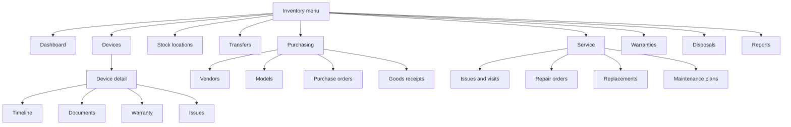
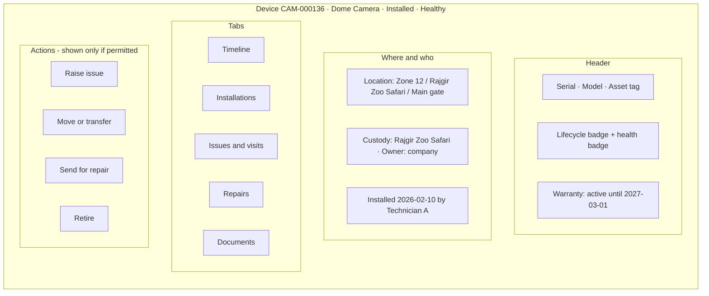
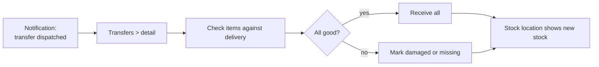
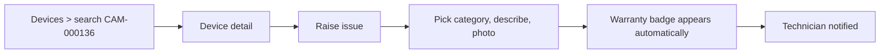
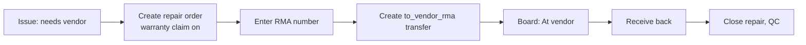

# 08 · FBOS UI

The inventory UI lives in the FBOS admin app: `fbos_frontend/clientadmin`, as a new module **`features/inventory/`**. The Fixly web app is frozen (no new features) and kept running for current customers until the FBOS UI reaches parity, then redirected.

> Screen names and layout are a proposal. Final designs come from the product owner.

## 1. Navigation map



## 2. Pages

| Page | Who uses it | What it shows | Key actions | Permissions |
|---|---|---|---|---|
| **Dashboard** | Everyone (content varies) | Stock by tier, open issues, transfers in transit, warranties expiring, out for repair | Jump to lists | `device.read` + others |
| **Devices** | Operator, company, site | Searchable register with model, status, health, holder, zone, warranty end | Filter, export, open detail | `device.read` |
| **Device detail** | Same | Identity, location now, custody, warranty, installation history, files | Install, raise issue, move | `device.read` |
| **Timeline** (tab) | Same | Full lifecycle from `device_lifecycle_events` | — | `device.read` |
| **Stock locations** | Operator, storekeepers | Platform / company / site stores with stock per model | Open stock, start transfer | `stock_location.read` |
| **Transfers** | Operator, storekeepers | List and detail; sender, receiver, items, status | Create, approve, dispatch, receive | `stock_transfer.*` |
| **Vendors / Models** | Operator | Master data | CRUD | `vendor.*`, `device_model.*` |
| **Purchase orders** | Operator | PO list, lines, approval status | Create, submit, approve | `purchase_order.*` |
| **Goods receipts** | Operator | GRN against a PO, serial capture, QC | Receive, accept, reject | `goods_receipt.*` |
| **Warranties** | Operator, company | Expiry calendar, claim status | Open claim | `warranty.read` |
| **Issues and visits** | Everyone | Issue list, status, warranty badge, visits | Raise, assign, log visit | `issue.*`, `service_visit.*` |
| **Repair orders** | Operator | Out-for-repair board, RMA, costs | Create, dispatch, close | `repair_order.*` |
| **Replacements** | Operator, company | Request, approval, spare picker, disposition | Request, approve | `replacement.*` |
| **Maintenance plans** | Operator | Plans and upcoming preventive visits | Create plan | `maintenance_plan.*` |
| **Disposals** | Operator | Retired devices awaiting disposal, certificates | Approve, record wipe | `disposal.*` |
| **Reports** | Operator, company | The reports in [design doc §11](../fixly-v2-design.md#11-reports-and-dashboards-this-model-enables) | Filter, export | `report.read` |

## 3. Device detail layout



## 4. How users move through it

### Storekeeper receives a delivery



### Zone staff reports a problem



### Operator handles a failed unit



## 5. Frontend structure

Follows `fbos_frontend/CLAUDE.md` conventions.

```
clientadmin/src/features/inventory/
├── api.js                  # one function per endpoint, base /api/inventory/v1
├── hooks/                  # useInventoryNames (id → name, like useDeliveryNames)
├── pages/
│   ├── DashboardPage.jsx
│   ├── devices/            # list, detail, timeline
│   ├── locations/
│   ├── transfers/
│   ├── purchasing/         # vendors, models, POs, GRNs
│   ├── service/            # issues, visits, repairs, replacements, maintenance
│   ├── warranties/
│   ├── disposals/
│   └── reports/
└── components/             # StatusBadge, WarrantyBadge, TransferItemsTable, DocumentPanel use
```

| Concern | How |
|---|---|
| Access gating | `features/auth/access.js` hides menu items and actions the user's permission list lacks |
| Files | Reuse `DocumentPanel` with subject types `inventory.*` |
| Names | Ids resolved to names via Identity / Revenue lookups, not copied |
| Dev proxy | Add `/api/inventory` → `INVENTORY_URL` to the Vite proxy |
| Feature flag | One flag per page; turning it off falls back to Fixly web during rollout |
| Docs | Add `/api/inventory` and the module to `fbos_frontend/CLAUDE.md` |

## 6. What a customer user sees

Customer staff (`client_user`) get the same pages with narrower data:

| Area | Customer view |
|---|---|
| Dashboard | Only their site(s) |
| Devices | Their site's devices; no cost or vendor price |
| Stock | Their site store |
| Purchasing, Vendors, Disposals, Reports with cost | Hidden (no permission) |
| Issues | Raise and follow their own |

## 7. Technician mobile app

The Flutter app stays on the legacy API through Phases 1–3. In Phase 4 it signs in with FBOS Identity (mobile refresh is already supported when the request sends `X-Client-Type: mobile`) and switches to the inventory API. It must store the refresh token and serialize refreshes, because reusing a refresh token revokes the whole session family.
