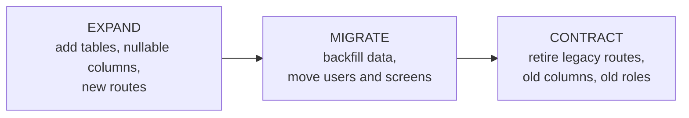
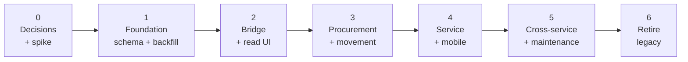
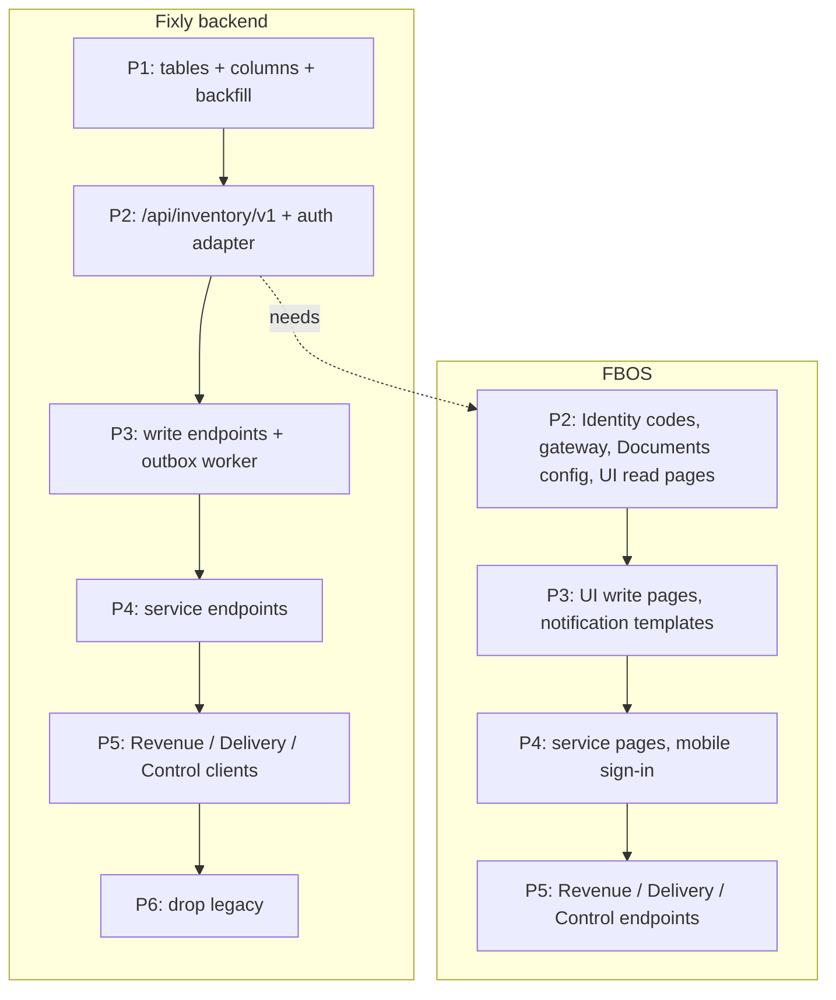
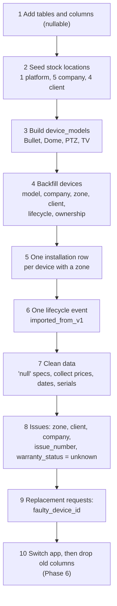

# 09 · Rollout and migration

Fixly is **live** (customers use it daily). FBOS is **not live**. So all change is done **additively**: add the new next to the old, move traffic, remove the old last.

## 1. Phases

| Phase | Scope | Exit gate |
|---|---|---|
| **0 Decisions + spike** | Answer D1–D5; glossary; OpenAPI; permission list; one-day spike: a `client_user` with a unit-scoped grant calls a Node endpoint through `/internal/authz/actor` | Spike passes; sign-off |
| **1 Foundation** | v2 schema added to Fixly (`lifecycle_state` column beside `status`; `Issue → Device` cascade → Restrict; soft delete; zone-delete guard); backfill; lifecycle events. Legacy app unaffected | Counts reconcile (445 devices, 5 / 4 / 227); legacy smoke test passes |
| **2 Bridge + read UI** | Identity permission codes **and** sensitive set; gateway entry; FBOS auth adapter; `/api/inventory/v1` read routes; Documents `inventory.*` access; Devices, Locations, Timeline pages | FBOS user with permission sees devices; a `client_user` sees only their site; unguarded-route test green |
| **3 Procurement + movement** | Vendors, models, PO, GRN, transfers, allocations, installations (writes) | A device walks PO → GRN → company → client → zone in the FBOS UI |
| **4 Service** | Issues, visits, warranty lookup, repair orders, replacement, disposal; mobile moves to Identity | Fault-to-resolution flow including RMA; technician app on new API |
| **5 Cross-service** | Revenue / Delivery / Control / Insight links; maintenance plans; event consumers if wanted | Contract → install → warranty → billable repair, end to end |
| **6 Contract legacy** | Redirect Fixly web; remove legacy role code; drop old columns; `code_sequences` | No traffic on legacy routes for 2 weeks |

## 2. What is added, when

## 3. Data migration v1 → v2

Order matters; each step is independently deployable ([design doc §9](../fixly-v2-design.md#9-migration-plan-v1--v2)).

### Identity migration (people)

| Step | Action |
|---|---|
| 1 | Match Fixly's 9 users to Identity users by email (globally unique) |
| 2 | Create missing Identity users; technicians become `contractor` / `employee` |
| 3 | Store `users.fbos_user_id`; keep Fixly `User` rows as a mapping layer |
| 4 | Force password reset; do not migrate hashes |
| 5 | Customer staff become `client_user` with unit-scoped grants |

### Customer migration

Each Fixly Company gets `fbos_customer_id` pointing at a Revenue client (create in Revenue if missing). Each Fixly Client becomes a "site".

## 4. Live-system safety rules

| Rule | Why |
|---|---|
| Additive migrations only until Phase 6 | Legacy app keeps working |
| Rehearse every migration and backfill on a **throwaway local DB** restored from a dump | Catch mistakes before production |
| Backfills are idempotent and have `--dry-run` | Safe to re-run |
| **Never run Alembic or Prisma migrate against the shared remote DBs from a dev machine** | Identity and Revenue share a remote MySQL |
| Each service migrates only its own DB | Avoid Prisma / Alembic conflicts |
| One feature flag per FBOS page | Roll back by flipping the flag |
| Rollback = flag off + legacy routes still served | Fast, no data restore |
| Legacy and new routers mounted separately | Two auth stacks never mix |
| Identity change deploys **before** inventory routes | Prevents the sensitive-code leak |

## 5. Test strategy

| Test | Proves |
|---|---|
| Cross-customer test on every list/detail endpoint | A `client_user` never sees another customer's data |
| Unguarded-route test | No inventory route without `requirePermission` |
| Reconciliation counts after backfill | 445 devices, 5 companies, 4 sites, 227 zones preserved |
| Legacy smoke test after each phase | Existing app still works |
| Rule tests (one active installation, one open transfer, atomic history) | Integrity rules hold under concurrency |
| Idempotency replay | Repeating GRN or dispatch makes no duplicates |
| Outbox failure test | Events survive Communication downtime |

## 6. Risks

| Risk | Mitigation |
|---|---|
| Customer data leaks across customers (`client_user` is only a label) | Phase 0 spike; cross-customer test in every list endpoint |
| New `.read` codes auto-granted to all members | Add sensitive codes in the same Identity change |
| Device cascade deletes issues; zone delete turns units into stock | Phase 1 fixes before any v2 write |
| No outbox worker in Node, no event consumers in FBOS | Notifications only first; consumers are new FBOS work |
| Documents calls inventory synchronously | Health checks + timeouts; accept that downtime blocks attach |
| Two auth systems during transition | Separate routers; no shared token |
| Dual writes drift (users, customers) | One owner per concept; sync by events; reconcile job |
| Prisma + Alembic ownership confusion | Strict per-service migration rule |
| Live data quality (344 `'null'` specs, missing prices and dates) | Cleanup before backfill; required fields at receiving |
| Event delivery gaps | Outbox + idempotent consumers + replay |

## 7. Definition of done for v2

- A device can be traced from purchase order to disposal in the FBOS UI with no gaps.
- Customer staff see only their own site.
- Technicians sign in with FBOS Identity.
- Legacy Fixly routes have had no traffic for two weeks and are removed.
