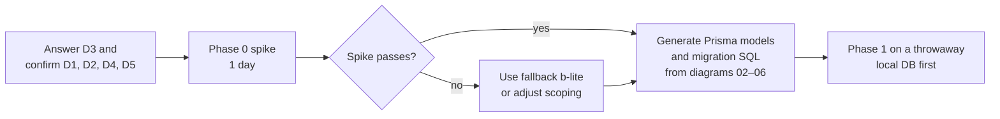

# 10 · Decisions and open questions

## 1. Integration decisions

| # | Decision | Status | Recommendation |
|---|---|---|---|
| **D1** | How customer staff sign in | Recommended, confirm in Phase 0 spike | `client_user` in the vendor organization, sites as org units, unit-scoped grants. Fallback: `self_only` grants + assignments in inventory |
| **D2** | Service name | Recommended | `inventory` (not `assets`, which already means IT assets) |
| **D3** | **Who owns devices after delivery** | **Needs your answer** | See below |
| **D4** | Fixly web app | Recommended | Keep until FBOS reaches parity, then retire on a set date |
| **D5** | Approvals | Recommended | Fixly-internal first; move to Control in Phase 5 |

### D3 in plain words

> After a device is delivered to a customer, **who owns it**: the customer, or you (and you lend it)?

| If the answer is… | Then |
|---|---|
| Customer owns it (sold) | Default `ownership_type = company_owned`. Warranty and repair may be billed to the customer |
| You own it (leased / lent) | Default `platform_owned` or `leased`. You carry repair and replacement cost; the customer holds custody only |
| Mixed | No default; choose per PO or per delivery |

The design supports all three. The answer sets the migration default for the 445 existing devices and the billing logic.

## 2. Architecture decisions already made

| Decision | Why |
|---|---|
| Fixly Node backend stays the system of record | Working, live, and not worth rewriting |
| No shared database | Prisma vs Alembic, coupling, different tenancy models |
| UI in FBOS, backend in Fixly | One admin experience; independent deploys |
| Outbox + worker, no event bus | FBOS has no bus; reuse the existing pattern |
| UUID cross-references, no cross-system foreign keys | Independent deploys and migrations |
| Keep `devices.status`, add `lifecycle_state` | MariaDB enum change is not additive |
| Keep `reserveCodes` generator until Phase 6 | Monotonic unique codes while legacy is live |

## 3. Open questions from the design doc

| # | Question | Why it matters |
|---|---|---|
| 1 | Ownership model (= D3) | Billing and defaults |
| 2 | Who orders? Only the platform, or can a company buy directly? | If companies can buy, add `purchase_orders.buyer_company_id` |
| 3 | Bulk / non-serial items (cables, power supplies, spare parts)? | Would need `inventory_items` with quantity per location (later phase) |
| 4 | Real approval levels and cost limits | The role matrix is a proposal |
| 5 | Do you run an in-house repair bench? | Decides whether `service_center` locations are yours or vendors' |
| 6 | Notification channels beyond the in-app inbox and mobile push | `device_tokens` stays for FCM; Communication handles inbox |
| 7 | Loaner devices during repair | Modelled as a normal replacement; add a "temporary swap" flag if the original must auto-reinstall |

## 4. New questions raised by the integration

| # | Question | Notes |
|---|---|---|
| 8 | Should each customer **site** be an Identity org unit? | Enables the cleanest scoping; otherwise use the b-lite fallback |
| 9 | Which Revenue client does each of the 5 existing companies map to? | Create in Revenue if missing |
| 10 | Which preset names do you want for the first release? | Section 3 of [06](06-access-and-permissions.md) is a starting list |
| 11 | Which dashboards are needed on day one? | Drives Phase 2 scope |
| 12 | What is the SLA per issue priority? | Needed for `sla_due_at` and, later, Control |
| 13 | When do you want to retire the Fixly web app? | D4; set a date after parity |
| 14 | Is billing of repairs in scope for v2 or later? | Phase 5 `billable` + `invoice_id` |

## 5. What happens next

