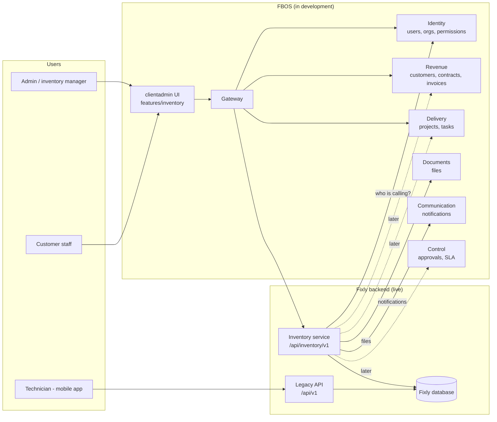

# Fixly v2 — Documentation

**Fixly v2** turns Fixly from a "list of installed cameras" into a full **hardware inventory, lifecycle and maintenance system**, and plugs it into **FBOS** so both products share people, customers, documents and notifications.

> Status: design complete, implementation not started. Written 2026-10-14.
> Source of truth for the table design: [`../fixly-v2-design.md`](../fixly-v2-design.md) and [`../diagrams/`](../diagrams/).
> Source of truth for the integration decisions: [`../FIXLY_V2_INTEGRATION_PLAN.md`](../FIXLY_V2_INTEGRATION_PLAN.md).

## How to read these docs

Diagrams are written in [Mermaid](https://mermaid.js.org). They render automatically on GitHub, in VS Code (Markdown preview, with the Mermaid extension on older versions), Obsidian and most Markdown viewers.

| # | Document | Read it if you want to know… | Audience |
|---|---|---|---|
| 01 | [Overview](01-overview.md) | What Fixly v2 is, why it exists, what changes, the vocabulary | Everyone |
| 02 | [Architecture & FBOS integration](02-architecture-and-fbos-integration.md) | How Fixly and FBOS connect, who owns what, how a request travels | Everyone, then engineers |
| 03 | [Device lifecycle](03-device-lifecycle.md) | Every state a device can be in and how it moves between them | Everyone |
| 04 | [Process flows](04-process-flows.md) | Step-by-step flows: order → install, fault → repair/replace, disposal, maintenance | Everyone |
| 05 | [Data model](05-data-model.md) | Tables, relations, rules that keep data correct | Engineers, analysts |
| 06 | [Access & permissions](06-access-and-permissions.md) | Who can see and do what, how customers are kept apart | Engineers, product, admins |
| 07 | [API & events](07-api-and-events.md) | Proposed endpoints, error shapes, notifications, documents | Engineers |
| 08 | [FBOS UI](08-fbos-ui.md) | Screens that live in the FBOS admin app and how users move between them | Product, designers, frontend |
| 09 | [Rollout & migration](09-rollout-and-migration.md) | Phases, how live data is migrated safely, risks | Everyone |
| 10 | [Decisions & open questions](10-decisions-and-open-questions.md) | What has been decided and what still needs an answer | Product owner |

## The whole system in one picture

**The three ideas to remember**

1. **One brain per topic.** Identity owns people. Revenue owns customers. Fixly's inventory service owns devices. Nobody copies another's data; they keep an ID and ask.
2. **UI in FBOS, data in Fixly.** Users work in the FBOS admin app; it talks to the Fixly backend through the FBOS gateway.
3. **Nothing breaks while we build.** Fixly is live. Every change is added next to the old one, then the old one is removed last.
